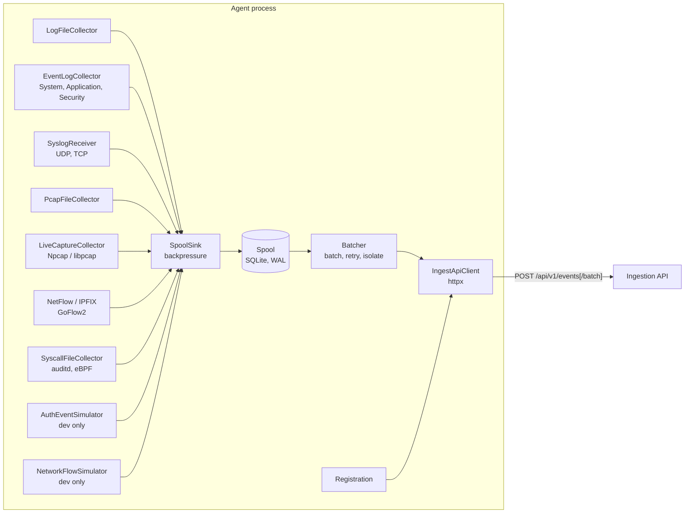

# Endpoint agent

`apps/agent` is the ADIS endpoint agent. It is defensive telemetry software: it reads
telemetry on a host the operator owns, normalizes it to the
[canonical event schema](EVENT_SCHEMA.md), buffers it durably and sends it to the
[ingestion API](API.md). It never changes the host it runs on: it reads what the host or
its operator already produces and writes only its own data directory.

Its collectors cover the four Phase 1 data types of the specification (pentra.pdf §2):
system logs (log files, Windows Event Log, syslog), network flows (PCAP files, live capture,
NetFlow/IPFIX), system calls (auditd log, eBPF tracer output) and user behavior (session
vectors from authentication logs). Privileged sources stay outside the agent: the operator
installs audit rules, runs the eBPF tracer, grants "Event Log Readers" or installs Npcap,
and the agent only reads the result. Every collector is off until configured.

## Architecture



| Module | Responsibility |
|---|---|
| `settings.py` | `AgentServiceSettings` = `AppSettings` + `AgentSettings` ([configuration](#configuration)). |
| `identity.py` | Stable agent UUID in `<data dir>/agent_id`, and host description. |
| `collectors/base.py` | `Collector` and `EventSink` protocols, `CollectorContext`. |
| `collectors/logfile.py` | Tails application and system log files. |
| `collectors/simulation.py` | Synthetic authentication events and network flows (development and test only). |
| `collectors/windows_events.py` | Windows Event Log reader (pywin32), XML parser, polling loop with per-channel checkpoints, System/Application mapping. |
| `collectors/windows_auth.py` | Security-log logons and logoffs → authentication events and session vectors. |
| `collectors/sessions.py` | Session vectors (user behavior) shared by the Windows and syslog collectors. |
| `collectors/packets.py`, `collectors/flows.py` | Header-only packet parsing (Scapy) and bidirectional 5-tuple flow aggregation. |
| `collectors/pcap.py`, `collectors/live_capture.py` | Flows from capture files and from one authorized interface. |
| `collectors/netflow.py` | NetFlow v5/v9 and IPFIX records decoded by GoFlow2, from authorized exporters only. |
| `collectors/syslog.py` | RFC 3164/5424 receiver; sshd and PAM messages become authentication events. |
| `collectors/syscalls.py`, `collectors/tail.py` | auditd and eBPF system calls → per-process call sequences; checkpointed file tailing. |
| `spool.py` | Durable local queue with a hard capacity, checkpoints and a quarantine. |
| `batcher.py` | Drains the spool in batches and handles every server response. |
| `client.py` | HTTP client. It maps each response to an `Outcome`, and never raises for HTTP or transport errors. |
| `backoff.py` | Exponential backoff with jitter. |
| `registration.py` | Announces the agent with a `system.agent_registered` event. |
| `agent.py` | Runtime: supervises collectors, registers, runs the batcher, shuts down cleanly. |
| `__main__.py` | Command-line interface. |

Collectors never talk to the network. They only submit canonical events to the sink,
which writes them to the spool. The batcher is the only component that sends telemetry,
so buffering, retry and delivery accounting live in one place.

## Delivery guarantees

The agent delivers events **at least once** and **never drops a queued event silently**.
Every event that leaves the spool without being delivered is counted, logged and
inspectable.

- **Durable before acknowledged.** Collectors advance their read position only in the
  same SQLite transaction that stores the events. That transaction uses
  `synchronous=FULL` and WAL. A crash therefore either keeps both or loses both, and a
  lost read is simply read again.
- **Bounded, never overflowing.** `AGENT_MAX_QUEUE_EVENTS` is enforced when events are
  appended.
  - A write that does not fit is refused as a whole.
  - The sink then applies **backpressure**: it logs `agent_spool_full`, wakes the sender
    and retries. Collection resumes (`agent_spool_resumed`) once delivered events free
    space.
  - Log files are not read further while the queue is full, and their unread lines
    stay in the file. Queued events are never evicted to make room.
- **Removed only on acknowledgement.** An event leaves the queue only when the API
  answers `202` and lists it as accepted.
- **Rejected events are quarantined, not deleted.**
  - An event the API refuses permanently is moved to the quarantine table with the
    server's reason. This happens for a per-event rejection in a `202` or `422`, or for
    a single event that is still `400`/`413` after isolation.
  - The agent logs `agent_events_quarantined`, and `status` shows the quarantined events.
  - The quarantine holds at most `AGENT_MAX_QUEUE_EVENTS` events. Older entries beyond
    that are removed and counted persistently (`quarantine_evicted`, logged as `agent_quarantine_evicted`).
- **Idempotent retries.** The IDs of log events are deterministic: UUIDv5 over agent,
  file identity, rotation generation and byte offset. Re-reading after a crash therefore
  reproduces the same `event_id`. The spool ignores duplicates, and downstream storage
  deduplicates on `event_id`.
- **Nothing is lost on shutdown.** On stop, collectors are cancelled first. The batcher
  then gets one final flush, bounded by `AGENT_HTTP_TIMEOUT_SECONDS`. Anything unsent
  stays in the spool for the next start.
- **A corrupt spool never stops the agent.** At start the spool runs SQLite's
  `quick_check`. A damaged database (disk failure, a copy taken mid-write) is renamed to
  `spool.sqlite3.corrupt-<UTC time>` with its WAL files, kept for inspection or manual
  recovery, and a fresh spool is created (`agent_spool_corrupt`, error). The events of
  the damaged file are not delivered automatically, and the log files are re-read from
  their start or end as for a new agent.

## Encryption at rest

Queued and quarantined events are encrypted in the spool (`AGENT_SPOOL_ENCRYPTION=true`,
the default), so a copy of the data directory (a backup, a disk image, another local
account) does not reveal telemetry. See `apps/agent/spool_crypto.py`.

- **Algorithm.** AES-256-GCM, a random 96-bit nonce per record, and the record's
  `event_id` as associated data: a record cannot be altered, truncated or moved to
  another row without detection.
- **Key.** 32 random bytes, created on first start in `<AGENT_DATA_DIR>/spool.key`:
  - on Windows the file holds the key wrapped with DPAPI for the agent's account, so it
    is useless on another machine or under another account;
  - on POSIX the file holds the key with mode `0600`, in the `0700` directory;
  - `AGENT_SPOOL_KEY` (32 bytes, base64url) supplies the key from a secret store
    instead, keeping it off the data directory.
- **Key check.** The spool stores an encrypted check value. If the key does not open it
  (the key file was lost or replaced, `AGENT_SPOOL_KEY` changed, or encryption was turned
  off for an encrypted spool), the spool is set aside as `spool.sqlite3.corrupt-<time>`
  and a new one is created (`agent_spool_key_mismatch`, error). The agent keeps running;
  with the right key the preserved spool can still be read.
- **Unusable key file.** A key file that cannot be read or unwrapped (for example, a
  DPAPI blob of another account) is renamed `spool.key.unusable-<time>` and replaced
  (`agent_spool_key_unusable`, error).
- **Altered record.** A record that fails authentication is moved to the quarantine
  with the reason `spool record failed its integrity check`
  (`agent_spool_record_unreadable`, error); the other events are still sent.
- **Upgrade.** A spool written before encryption stays readable. New records are
  encrypted, and the key check is upgraded, so encryption cannot be turned off again
  for that spool without setting it aside.
- **Not encrypted:** checkpoints (file positions and paths) and counters.
- `python -m apps.agent status` shows the protection in use (`spool_encryption`).

## Sending and retry

The batcher sends up to `AGENT_BATCH_SIZE` events every `AGENT_FLUSH_INTERVAL_SECONDS`.
It sends sooner when a full batch is waiting, and it keeps sending until the queue is
empty.

| API response | Outcome | Agent behaviour |
|---|---|---|
| `202` | `DELIVERED` | Acknowledge accepted events; quarantine per-event rejections. |
| `422` | `REJECTED` | Quarantine the rejected events; acknowledge none. |
| `413` / `400` | `TOO_LARGE` / `MALFORMED` | Halve the batch size and retry, to isolate the offending event. A single offending event is quarantined. |
| `429` | `RATE_LIMITED` | Wait `Retry-After`, or back off. |
| `401` / `403` | `UNAUTHORIZED` | Keep events and back off; logs `agent_send_refused` at error level. |
| other `4xx` | `MISCONFIGURED` | Keep events and back off; logs `agent_send_refused`. |
| `5xx`, timeout, connection error | `UNAVAILABLE` | Keep events; wait `Retry-After` or back off (`agent_send_retry`). |

The backoff is exponential with equal jitter. It starts at
`AGENT_RETRY_INITIAL_BACKOFF_SECONDS` and doubles up to
`AGENT_RETRY_MAX_BACKOFF_SECONDS`. The wait is always at least half the current ceiling,
and a successful send resets it. Each request carries a fresh `X-Request-ID`, which the
API echoes in its logs.

## Identity and registration

- **Stable agent UUID.** On first start the agent creates `<AGENT_DATA_DIR>/agent_id`
  with a random UUID. It creates the file exclusively, with mode `0600`, and syncs it to
  disk. The directory is created with mode `0700`.
  - POSIX modes do not apply on Windows, where the directory would inherit its parent's
    ACL. There the agent removes inheritance with `icacls` and grants access only to the
    current user and `SYSTEM`; files created inside inherit that. If `icacls` fails, the
    agent logs `agent_data_dir_acl_failed` and keeps running.
  - Every later start reuses that UUID; it is the `agent_id` of every event.
  - An empty file means creation was interrupted, and a new UUID is written.
  - A file that is not a UUID stops the agent with exit code 2. The file is never
    replaced, because that would silently create a second identity for the same host.
    Restore it from backup, or delete it deliberately.
- **`host_id`** is the lower-cased host name reduced to `[a-z0-9._-]`, and it is the Kafka
  partition key. `AGENT_NAME` defaults to the host name.
- **Registration.** At every start the agent sends a canonical `system.agent_registered`
  `SystemEvent` and waits for it to be acknowledged before any spooled telemetry is sent.
  - The event carries the agent id, name, host name, OS type and agent version.
  - Collectors keep buffering while it retries.
  - The event id is derived from those attributes. Repeated announcements are therefore
    idempotent, and an upgrade or rename produces a new one.
  - The last successful registration is recorded in the spool and shown by `status`.
  - A permanent rejection (`400`/`413`/`422`) stops the agent with exit code 1.
  - The [normalizer](NORMALIZER.md#agent-registry) keeps `adis.agents` current from
    these events: the agent row is created or refreshed, and the agent's stored events
    are linked to it and move its `last_seen` forward.
- **Agent-bound token.** Give each agent a token whose API client id is
  `agent-<its agent_id>` in `API_INGEST_TOKENS`
  ([API.md](API.md#authentication)). The API then accepts from that token only events
  carrying that `agent_id`. To know the id before the first start, create
  `<AGENT_DATA_DIR>/agent_id` yourself with a UUID (one line).
- **Host-bound token.** List the agent's `host_id` for that client in the API's
  `API_INGEST_CLIENT_HOSTS` (`agent-<its agent_id>=<host_id>`). The agent derives its
  `host_id` from the host name (lower-cased, see `build_identity`), so renaming a host
  means updating the entry. Required in staging and production
  ([API.md](API.md#authentication)).

## Collectors

### Log files (`logfile`)

`AGENT_LOG_FILES` is a comma-separated list of files to tail, polled every
`AGENT_LOG_POLL_INTERVAL_SECONDS`.

- Each complete line becomes a `SystemEvent`:
  - `event_type` is `system.log_entry` and `source_type` is `logfile`.
  - `source_name` is `logfile@<agent name>`.
  - `metadata` holds `path`, `offset` and `message`.
- The **severity hint** comes from keywords in the line:
  - `crit`, `fatal`, `panic` and similar → `high`;
  - `error` or `fail` → `medium`;
  - `warn` → `low`;
  - anything else → `info`.
- **Secrets are redacted** before a line leaves the host. `password=…`, `token: …`,
  bearer credentials and similar become `[REDACTED]`, using the same redaction as ADIS's
  own logs.
- **Position tracking.**
  - A new file is read from its end unless `AGENT_LOG_READ_FROM_START=true`.
  - The position (device, inode, rotation generation, offset) is checkpointed with the
    events.
  - Rotation (a new inode) and truncation are detected: reading restarts at the beginning
    of the new content, and `agent_logfile_rotated` is logged.
- **Limits.**
  - A missing file is logged once (`agent_logfile_missing`) and picked up when it
    appears.
  - A partial last line waits for its newline.
  - A line longer than 16 KiB is split into 16 KiB events.
  - At most 1 MiB is read per file per poll.
- Only files the agent's user can read are collected. Run the agent as an unprivileged
  user, in the group that owns the logs (for example `adm` on Debian/Ubuntu).

### Simulators (`auth-simulator`, `flow-simulator`), development and test only

Synthetic telemetry for exercising the pipeline and, later, the detectors. The rates are
`AGENT_SIMULATE_AUTH_PER_MINUTE` and `AGENT_SIMULATE_FLOWS_PER_MINUTE`, and the collector
is disabled at `0`.

| Simulator | Event | Scenarios (approximate share) |
|---|---|---|
| Authentication | `AuthenticationEvent`, `authentication.login` | `normal_login` (70 %), `mistyped_password` (15 %), `password_bruteforce` (15 %, from a few fixed sources against common account names) |
| Network flow | `NetworkFlowEvent`, `network.flow` | `web_browsing`, `dns_lookup`, `internal_ssh` (together 88 %), `port_scan` (7 %), `large_outbound_transfer` (5 %) |

Safety properties:

- They generate records only. Nothing is sent to any address in the records, and no
  packets or login attempts are made.
- Every address comes from private (`10.0.0.0/16`) or documentation ranges
  (`192.0.2.0/24`, `198.51.100.0/24`, `203.0.113.0/24`, RFC 5737). Real hosts are never
  named.
- Every event is labelled: `source_type="simulator"`, `metadata.simulated=true` and
  `metadata.scenario`. Detectors and evaluation can therefore separate synthetic from
  real telemetry.
- Configuration refuses non-zero simulation rates unless `APP_ENV` is `development` or
  `test`. `simulate` and `generate` refuse to run otherwise.

### Real telemetry collectors (Phase 1 per pentra.pdf §2)

Ported from the separate Phase 1 implementation "muna" (Windows logs, PCAP, live capture,
NetFlow) into this agent, so they share its spool, token, retries and canonical schema,
and extended with syslog, system calls and session vectors. Every collector is off until
its setting is given ([DEVELOPMENT.md](DEVELOPMENT.md#endpoint-agent-agentsettings)).

| Data type (pentra.pdf) | Collector | Enable with | `source_type` | Event types |
|---|---|---|---|---|
| System logs | Windows Event Log | `AGENT_WINDOWS_EVENTLOG_CHANNELS=System,Application` | `windows_eventlog` | `system.service_installed`, `system.event_log_cleared`, `system.unexpected_reboot`... or `system.windows_event` |
| System logs | Syslog receiver | `AGENT_SYSLOG_UDP_LISTEN` / `_TCP_LISTEN` | `syslog` | `system.syslog` |
| Network flows | PCAP files | `AGENT_PCAP_FILES` | `pcap` | `network.flow` |
| Network flows | Live capture | `AGENT_LIVE_CAPTURE_INTERFACE` + `AGENT_LIVE_CAPTURE_AUTHORIZED=true` | `live_capture` | `network.flow` |
| Network flows | NetFlow v5/v9, IPFIX | `AGENT_NETFLOW_EXPORTERS` + `_GOFLOW2_PATH` or `_RECORDS_FILE` | `netflow` | `network.flow` |
| System calls | auditd log | `AGENT_AUDIT_LOG_FILE` | `auditd` | `process.syscall_sequence`, `process.started` |
| System calls | eBPF tracer output | `AGENT_EBPF_EVENTS_FILE` | `ebpf` | `process.syscall_sequence`, `process.started` |
| User behavior | Windows Security log | `AGENT_WINDOWS_SECURITY_ENABLED=true` | `windows_security_log` | `authentication.login`, `.logout`, `.session_started`, `.session_ended`, ... |
| User behavior | sshd and PAM via syslog | the syslog receiver | `syslog` | `authentication.login.ssh`, `.login.pam`, `.session_started`, `.session_ended` |

**Windows Event Log.** Reads the local channels through the Evt* API (pywin32) without
administrator rights for System and Application; the Security channel needs "Event Log
Readers" or an elevated agent, and without it the collector reports *access denied* and
retries every 60 s while the other channels keep working. The last record of each channel
is checkpointed with its events; a first run starts at the newest record unless
`AGENT_WINDOWS_EVENTLOG_BACKFILL_MINUTES` asks for history; cleared and wrapped logs are
detected. Event ids are UUIDv5 of computer, channel, record id and time. Data fields whose
names look like secrets are dropped, other values are redacted and truncated, the message
text is opt-in and personal SIDs are never sent.

**Security log and session vectors.** 4624/4625 become `authentication.login` (success or
failure with a normalized `failure_reason`), 4634/4647 logouts, 4648 explicit credentials,
4672 administrative privileges and 4740 lockouts. A failed logon for a name that is not an
account withholds the typed name (it may be a password). Interactive logons (types 2, 7,
10, 11) open a *session vector* and the logoff closes it:
`metadata.session_vector = {schema, fields, vector, values, started_at}` with duration,
start hour and weekday, logon type, failed attempts and distinct failure sources in the
preceding window, privileged (4672, also through the linked logon id of UAC logons),
remote source, concurrent sessions and explicit-credential uses. Only
`authentication.login*` events count as login attempts for the feature generator.

**Syslog.** RFC 5424 and RFC 3164 (classic or ISO-dated) over UDP and TCP (octet-counted
or newline-framed). The listener binds one configured address (never `0.0.0.0`; non-loopback
only with `AGENT_SYSLOG_ALLOW_NON_LOOPBACK=true`) and accepts only
`AGENT_SYSLOG_ALLOWED_SENDERS`. `host_id` is the message's host name, or the sender address.
sshd `Accepted`/`Failed`/`Invalid user` lines and PAM authentication failures become
authentication events; PAM `session opened/closed` lines become session vectors. Names of
attempts for nonexistent accounts are withheld from the event *and* from its message text.
Classic RFC 3164 headers have no year or zone, so such events are dated on receipt.

**Flows from packets (PCAP and live capture).** Scapy decodes only link, IP and TCP/UDP
headers. Packets are grouped into **bidirectional** 5-tuple flows: the first packet's
sender is the initiator, `bytes_sent`/`bytes_received` count each direction, and
`metadata` carries the extracted features (duration, packets and frame bytes per direction,
TCP flags and their counts per direction, fragments, end reason). Flow ids are
deterministic, so a file read twice is deduplicated by the normalizer. A capture file is
read once and again when it changes. Live capture needs Npcap (Windows) or libpcap
(Linux), installed by an administrator; it uses only the configured interface, keeps
promiscuous mode off unless `AGENT_FLOW_ALLOWED_NETWORKS` names the lab networks, filters to
the interface's own addresses inside the driver, captures `AGENT_LIVE_CAPTURE_SNAPLEN` bytes
per packet and excludes the agent's own API and Kafka traffic. `python -m apps.agent
interfaces` lists the interfaces and whether capture is available.

**NetFlow v5/v9 and IPFIX.** GoFlow2 decodes the exports with
`infrastructure/goflow2/adis-mapping.yaml`; the agent either runs it
(`AGENT_NETFLOW_GOFLOW2_PATH`, listening on `AGENT_NETFLOW_LISTEN`) or reads the JSON file a
separately run GoFlow2 writes (`AGENT_NETFLOW_RECORDS_FILE`, checkpointed). Only exporters
in `AGENT_NETFLOW_EXPORTERS` are accepted; the exporter's name is the flow's `host_id`.
Counts stay as exported, sampling is reported, reverse counters of bidirectional records
fill `bytes_received`, and fields the exporter did not send are not invented.

**System calls (auditd and eBPF).** The operator installs `infrastructure/auditd/adis.rules`
or runs `infrastructure/ebpf/adis-syscalls.bt` (bpftrace) with the privileges they need;
the agent only tails the resulting file. Calls are grouped per process into
`process.syscall_sequence` events (the specification's *call sequences*) when the window
(`AGENT_SYSCALL_WINDOW_SECONDS`) passes or `AGENT_SYSCALL_MAX_SEQUENCE` calls accumulate:
`metadata.syscalls` is the ordered sequence, with counts, failures, first/last time and
uids. A successful `execve`/`execveat` also emits `process.started`, which feeds the
process features of Phase 2. Command-line arguments are never collected. The checkpoint
stays before the oldest open sequence, so a restart rebuilds it with the same event ids.
x86_64 and aarch64 syscall numbers are translated; audit's `ENRICHED` format is also read.

## Command line

`python -m apps.agent <command>` reads configuration from the environment and `.env`
([DEVELOPMENT.md](DEVELOPMENT.md#endpoint-agent-agentsettings)).

| Command | `make` | Purpose |
|---|---|---|
| `run [--duration S]` | `make agent` | Run the configured collectors and send to `AGENT_SERVER_URL` until SIGINT/SIGTERM (Ctrl+C on Windows), or for `S` seconds. |
| `interfaces` | – | List the network interfaces (index, name, description, addresses) and whether live capture is available, as JSON. |
| `simulate [--auth-per-minute N] [--flows-per-minute N] [--duration S]` | `make agent-simulate` | Like `run`, with both simulators enabled (defaults: 120 and 300 per minute). Development and test only. |
| `status` | `make agent-status` | Print identity, queue depth, capacity, quarantine (last five with reasons) and last registration as JSON. It does not contact the server. |
| `generate {auth,flows} [--count N] [--seed S] [--batch]` | – | Print synthetic canonical events, one JSON object per line, or with `--batch` one `{"events": [...]}` body for `POST /api/v1/events/batch`. It needs no server, token or data directory. Development and test only. |

Exit codes: `0` success; `1` registration permanently rejected; `2` configuration or
identity error (the message names the variable, never its value).

### Local end-to-end run

1. Start Kafka and the ingestion API ([API.md](API.md#running-locally)). Give the agent
   its own client token in `API_INGEST_TOKENS`, for example
   `API_INGEST_TOKENS=agent-dev:<token>`.
2. In `.env`, set `AGENT_TOKEN=<the same token>`. The default
   `AGENT_SERVER_URL=http://127.0.0.1:8000` targets the local API.
3. Run `make agent-simulate`, or add `AGENT_LOG_FILES=/path/to/app.log` and run
   `make agent`.
4. Watch `make agent-status`: `queued` should stay near zero. Consume
   `auth_events` / `network_flows` to see the events arrive.

Without Kafka, the `generate` output can be posted directly:

```bash
python -m apps.agent generate auth --count 20 --batch > batch.json
curl -sS -X POST http://127.0.0.1:8000/api/v1/events/batch -H "Authorization: Bearer <token>" -H "Content-Type: application/json" --data-binary @batch.json
```

## Configuration

All variables are documented in
[DEVELOPMENT.md](DEVELOPMENT.md#endpoint-agent-agentsettings). Notes for deployment:

- `AGENT_TOKEN` is required and secret. It must match a `client:token` entry of
  `API_INGEST_TOKENS`. Tokens are per client, so give each agent (or fleet) its own and
  rotate them individually (OD-16).
- In `staging` and `production`:
  - `AGENT_SERVER_URL` and `AGENT_DATA_DIR` must be set explicitly.
  - `AGENT_SERVER_URL` must use `https`.
  - Simulation must be off.
- `AGENT_DATA_DIR` holds `agent_id` (the identity) and `spool.sqlite3` (the queue). Put it
  on persistent local storage, exclude it from shared or synced folders, and back up
  `agent_id` if the identity must survive a rebuild.
- Size `AGENT_MAX_QUEUE_EVENTS` for the longest server outage to ride out. Canonical
  events are capped at 128 KiB, and typical log and flow events are well under 1 KiB.
  At 100 events/s, the default of 100 000 events covers about 17 minutes.

## Observability

The agent writes the standard ADIS JSON logs ([DEVELOPMENT.md](DEVELOPMENT.md#logging-conventions))
with `service` = `APP_NAME`. Every line of a run carries the agent's `host_id`, and the
`action` field identifies what happened:

| `action` | Level | Meaning |
|---|---|---|
| `agent_started`, `agent_stopped` | info | Lifecycle, with collector names and final queue depth. |
| `agent_registered`, `agent_registration_retry` | info / warning | Registration progress. |
| `agent_events_delivered` | debug | Batch acknowledged. |
| `agent_send_retry` | warning | Server unavailable or rate limiting; events kept. |
| `agent_send_refused` | error | Token refused (`401`/`403`) or unexpected `4xx`; events kept. Check `AGENT_TOKEN` and `AGENT_SERVER_URL`. |
| `agent_send_unresolved` | warning | The server acknowledged part of a batch but neither accepted nor rejected the rest; they stay queued and are retried. |
| `agent_batch_split` | warning | `400`/`413`; the batch size is halved to isolate an offending event. |
| `agent_events_quarantined`, `agent_quarantine_evicted` | error | Events permanently rejected; the quarantine overflowed. |
| `agent_spool_full`, `agent_spool_resumed` | warning / info | Backpressure on and off. |
| `agent_collector_failed` | error | A collector crashed; it is restarted after 5 s. |
| `agent_logfile_missing`, `agent_logfile_rotated` | warning / info | Log file state changes. |
| `agent_spool_corrupt` | error | The spool failed its integrity check and was set aside; a new one was created. |
| `agent_spool_key_mismatch`, `agent_spool_key_unusable` | error | The key does not open the spool, or the key file is unusable; it was set aside and replaced ([Encryption at rest](#encryption-at-rest)). |
| `agent_spool_record_unreadable` | error | Spool records failed authentication and were quarantined. |
| `agent_data_dir_acl_failed`, `agent_data_dir_acl_skipped` | warning | The Windows ACL of the data directory could not be restricted. |
| `agent_final_flush_timeout` | warning | Shutdown before the queue drained; the rest is sent at next start. |

The token is never logged, and raw log lines appear only after redaction.

## Troubleshooting

| Symptom | Likely cause |
|---|---|
| Exit code 2 naming `AGENT_TOKEN` | Token unset or blank. |
| `agent_send_refused` with status `401` | `AGENT_TOKEN` is not in the API's `API_INGEST_TOKENS`. |
| Events quarantined with `agent_mismatch` | The token is bound to another agent (`agent-<uuid>` client id) than this data directory's `agent_id`. |
| Events quarantined with `host_mismatch`, or exit code 1 on registration | The API restricts this token to other hosts (`API_INGEST_CLIENT_HOSTS`), for example after the host was renamed: its `host_id` is no longer listed. |
| `queued` keeps growing | The server is unreachable or refusing; see `agent_send_retry` / `agent_send_refused`. Events are safe until the queue is full, then collection pauses. |
| `quarantined` > 0 | See `status` → `recent_quarantine` for the server's reasons, usually a schema mismatch between agent and API versions. |
| Exit code 2: "…agent_id … restore it" | The identity file is corrupt; see [Identity and registration](#identity-and-registration). |
| No log events | The file does not exist yet, is not readable by the agent's user, or only old lines exist (new files are read from the end unless `AGENT_LOG_READ_FROM_START=true`). |

## Tests

- `tests/unit/agent` needs no external services:
  - identity and backoff;
  - spool capacity, deduplication, checkpoints and quarantine;
  - response classification;
  - batcher retry, isolation and quarantine;
  - collectors (rotation, truncation, redaction, simulator safety);
  - registration, runtime supervision and backpressure;
  - the CLI.
- `test_contract.py` runs the agent against the real ingestion API application
  in-process, with an in-memory Kafka publisher. It pins the agent–API contract:
  registration, delivery, redaction, wrong token and server-side rejection.
- The end-to-end verification ([VERIFICATION.md](VERIFICATION.md)) runs the real
  `python -m apps.agent run` process on a log file, with an agent-bound token, through
  an API outage and a hard kill of the agent. Every line must be stored exactly once and
  linked to the agent's row in `adis.agents`.
