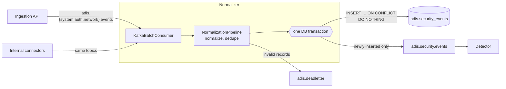

# Normalization pipeline

`apps/normalizer` turns accepted telemetry into the single stream that detection reads.

1. It consumes `system_logs`, `auth_events` and `network_flows`.
2. It normalizes every record to the [canonical event schema](EVENT_SCHEMA.md) and
   deduplicates it by `event_id`.
3. It stores each event in Supabase PostgreSQL (`adis.security_events`) and publishes it
   to `adis.security.events`.
4. Records that cannot become a valid canonical event go to `adis.deadletter`.



## Topics

| Topic | Role |
|---|---|
| `system_logs` | Input: accepted `system`, `process` and `security` category telemetry |
| `auth_events` | Input: accepted `authentication` telemetry |
| `network_flows` | Input: accepted `network` telemetry |
| `adis.security.events` | **Output**: normalized, deduplicated, stored canonical events of every category, keyed by `host_id` |
| `adis.deadletter` | Records that could not be normalized or stored, with `adis-dlq-*` failure headers |

The three input topics are "accepted, not yet normalized"; nothing downstream should read
them. The ingestion API routes each category to one of them
(`packages.kafka.telemetry_topic`). `security`-category findings travel on
`system_logs`, so that no event reaches `adis.security.events` without passing
through the normalizer.

## Processing guarantees

Each poll (up to `NORMALIZER_BATCH_MAX_RECORDS` records) is processed as one batch:

1. **Normalize and validate** every record (see [Normalization rules](#normalization-rules)).
   Invalid records are set aside for the dead-letter topic.
2. **Deduplicate within the batch** by `event_id`; the first occurrence wins. A repeat
   whose content differs is a **conflict** (see below).
3. **Store, then publish, in one database transaction.**
   - Agent registrations in the batch are applied to `adis.agents` first (see
     [Agent registry](#agent-registry)), so the batch's telemetry links to its agent.
   - The events are written with `INSERT … ON CONFLICT (event_id) DO NOTHING RETURNING
     event_id`.
   - Events that were already stored are compared with the stored payload: same
     content is a duplicate, different content a conflict.
   - Only the newly inserted events are published to `adis.security.events`.
   - `adis.agents.last_seen` moves forward for the agents that reported.
   - The transaction commits only after the broker acknowledged every one (`acks=all`).
4. **Dead-letter** the invalid records and the conflicts, with their original bytes and
   headers.
5. **Commit the Kafka offsets**, once per partition per poll. This happens only after
   steps 3 and 4 succeeded.

The central invariant is that **a stored row implies its event was published**. That
makes deduplication against the table safe:

| Situation | Result |
|---|---|
| The same event submitted twice (agent retry, API resubmission) | One row, one publication. The first stored version wins. |
| A batch redelivered after a crash, or a replay with a new consumer group | No new rows, no new publications. |
| Publishing fails or times out | The transaction rolls back, and the retry publishes again. No event is lost. |
| The process dies after publishing, before committing | The redelivered record is published again (at-least-once) and stored once. |
| A commit that succeeded but reported an error | The retry finds the rows and does not publish again. |
| Two normalizers race on one `event_id` | The unique index serializes them. Only the transaction that inserts the row publishes. |

Output delivery is therefore **at-least-once**, like every ADIS topic, and consumers of
`adis.security.events` still deduplicate by `event_id`. Rows are **exactly-once**, and
duplicate events never produce duplicate database rows.

### Conflicting duplicates

Two records with the same `event_id` but different content are not the same event: a
buggy producer reused an id, or someone tries to overwrite stored evidence. Content is
compared on the canonical payload **ignoring** `received_at`, `trace_id` and
`metadata.adis_ingestion` (they legitimately change on resubmission).

- The stored event is kept unchanged, and nothing is published again.
- The newcomer is dead-lettered as `ConflictingDuplicateError`, so it can be inspected;
  it is counted in `conflicts` and `adis_normalizer_events_total{outcome="conflict"}`.

### Agent registry

Agents announce themselves with a `system.agent_registered` event
([AGENT.md](AGENT.md#registration)). For each valid registration (a UUID `agent_id` and
non-empty `name`, `hostname`, `os_type`, `agent_version` metadata), `adis.agents` is
upserted:

- a new agent becomes `active` with `first_seen = last_seen = received_at`;
- a known agent gets the registration's attributes; `first_seen` only moves earlier and
  `last_seen` only later, so replays never rewind history;
- a `decommissioned` agent stays decommissioned.

Every stored event of a registered agent is linked to it (`security_events.agent_id`),
and moves the agent's `last_seen` forward.

## Failures and retries

| Failure | Handling |
|---|---|
| Record is not a valid envelope, or not a valid canonical event | Dead-lettered immediately; the rest of the batch continues. |
| Database or broker outage: connection loss, timeouts, pool exhaustion, deadlock or serialization failure, `SQLSTATE` classes 08/53/57, retriable Kafka errors | Retried with exponential backoff and jitter (`NORMALIZER_RETRY_*`) **until it recovers**. Nothing is committed meanwhile, and valid events are never dead-lettered because of an outage. |
| Any other error while storing or publishing a batch | The batch is split. Each event is retried alone up to `NORMALIZER_MAX_ATTEMPTS` times, and outages are still retried indefinitely. An event that keeps failing is dead-lettered as `PersistenceError`; the others are stored and published. |
| Dead-letter topic unreachable | Retried until it recovers; the offsets stay uncommitted. |
| Shutdown (SIGINT/SIGTERM) | The batch in progress finishes. If it is waiting out an outage, the wait is interrupted and the batch stays uncommitted, to be redelivered after restart. |
| Consumer group rebalance | Assignments and revocations are logged (`kafka_partitions_assigned`, `kafka_partitions_revoked`). A refused offset commit is logged (`kafka_commit_failed`), not raised. The records are redelivered to the partitions' new owner, and the duplicate suppression skips them. |
| Kafka or the database unreachable at start-up | The service keeps retrying the connection with backoff (`normalizer_kafka_connect_retry`, `kafka_consumer_connect_retry`), instead of exiting; `/ready` answers `503` meanwhile. |

An outage longer than the broker's `max.poll.interval.ms` (5 minutes by default) makes the
group rebalance while the normalizer waits. That is harmless for the same reason.

Dead-letter messages name the failing field or error type, and never the value.
`PersistenceError` keeps only the exception type and `SQLSTATE`, because database messages
quote the offending value. Replay a dead letter by re-publishing its value and key to its
`adis-dlq-original-topic` (see [DEVELOPMENT.md](DEVELOPMENT.md#dead-letter-handling)).

## Normalization rules

Today the ingestion API only publishes canonical events, and those pass through
unchanged. The rules exist for internal connectors (Zeek, Suricata, dataset replay) that
publish source-shaped values directly to the input topics. Every record must still be an
`EventEnvelope`.

| Field | Rule |
|---|---|
| `event_id`, `event_type`, `trace_id`, `timestamp` | Taken from the envelope when the payload omits them. When present, they must match the envelope. |
| `schema_version` | Latest supported minor version of the envelope's `event_version`, when omitted. |
| `category` | Derived from the `event_type` prefix, when omitted. |
| `timestamp`, `received_at` | Epoch numbers, or numeric strings, in s/ms/µs/ns become UTC. The unit is inferred from the magnitude, and only 2000–2099 is accepted, where the ranges cannot overlap. RFC 2822 dates are converted. ISO 8601 offsets are converted to UTC by the schema. **Values without a zone are rejected**, never assumed UTC. `received_at` is set to the normalization time when missing. A `timestamp` more than `NORMALIZER_MAX_FUTURE_SKEW_SECONDS` (default 300) ahead of `received_at` is **kept but flagged**: `metadata.adis_ingestion.timestamp_skew_seconds` (see below), a `normalizer_future_timestamp` warning and `adis_normalizer_future_timestamps_total`. A skewed clock or a forged timestamp must stay visible to detection, not be silently dropped or trusted. |
| `src_ip`, `dst_ip` | Whitespace and brackets are stripped, and the canonical form is used: compressed lower-case IPv6, with IPv4-mapped addresses becoming IPv4. `""` and `"-"` mean unset. Leading-zero octets, integers and networks are rejected. |
| `src_port`, `dst_port` | Decimal strings and integral floats become integers; `""` and `"-"` mean unset. |
| `protocol` | Lower-cased. Numeric strings become IANA numbers (`"6"` → `tcp`). Aliases are mapped: `tcp4/tcp6` → `tcp`, `udp4/udp6` → `udp`, `icmp6/ipv6-icmp` → `icmpv6`, `ipsec-esp` → `esp`, and so on. **Unknown names are rejected, not guessed**. |

Everything else must already be canonical. Values the rules do not recognize are left
unchanged, so the canonical schema rejects them with a precise, value-free reason.

## Ingestion metadata

Every event gains `metadata.adis_ingestion`, which is stored and published:

```json
"adis_ingestion": {
  "normalizer": "adis-normalizer",
  "normalized_at": "2026-09-25T12:30:00Z",
  "producer": "adis-api",
  "source_topic": "auth_events",
  "source_partition": 2,
  "source_offset": 1841,
  "ingest_client": "agent-a",
  "request_id": "0123456789abcdef0123456789abcdef",
  "normalized_fields": ["timestamp", "protocol"],
  "timestamp_skew_seconds": 31536000.0
}
```

- `normalizer` is the service's `APP_NAME`, and `producer` is the envelope's producer.
- `ingest_client` and `request_id` come from the API's `adis-ingest-client` and
  `adis-request-id` headers, when they are valid. The same headers are forwarded on the
  output record.
- `normalized_fields` lists the fields the rules rewrote. It is omitted when there are
  none.
- `timestamp_skew_seconds` is present only when `timestamp` lies further ahead of
  `received_at` than `NORMALIZER_MAX_FUTURE_SKEW_SECONDS`.
- The key is **reserved**: a value supplied by a producer is always replaced, so
  provenance cannot be forged.
- If the event's `metadata` is too close to its 64 KiB limit to take the block, the block
  is left out (`normalizer_enrichment_dropped`) and the event is kept, as EVENT_SCHEMA.md
  requires.

## Running

```bash
python -m apps.normalizer
```

The equivalent `make` target is `make normalizer`.

- **Prerequisites.** Kafka with the ADIS topics (`make kafka-topics`), and a database
  migrated to head (`make db-upgrade`). `SUPABASE_DB_URL` is required; Supabase API keys
  are not needed.
- **Scaling.** Run more replicas with the same `NORMALIZER_CONSUMER_GROUP`. Partitions are
  split among them, and ordering per `host_id` holds within an input partition.
- **Replaying history.** Use a new consumer group: stored events are recognized, so
  nothing is duplicated.
- **Exit codes.** `0` after a clean stop; `2` for a configuration error. Anything else
  is an unexpected error, and restarting is safe.
- **Supervision.** In containers (`docker compose --profile app`), Docker restarts the
  process whenever it exits (`restart: unless-stopped`) and probes `/health`.
- **Health, readiness and metrics.** `NORMALIZER_HEALTH_HOST:NORMALIZER_HEALTH_PORT`
  (default `127.0.0.1:9102`; port `0` disables it) serves `GET /health` (the process is
  alive), `GET /ready` (`200` when the Kafka consumer and producer are connected and the
  database answers, `503` otherwise, with `checks`) and `GET /metrics`. A check that
  outlasts `DB_HEALTH_CHECK_TIMEOUT_SECONDS` plus 2 s is answered `503`
  (`{"status": "timeout"}`, logged as `health_route_timeout`), never left unanswered.

Configuration: [DEVELOPMENT.md](DEVELOPMENT.md#normalization-pipeline-normalizersettings),
plus the `KAFKA_*` and `DB_*` sections.

## Observability

JSON logs ([DEVELOPMENT.md](DEVELOPMENT.md#logging-conventions)). The `action` field
identifies what happened:

| `action` | Level | Meaning |
|---|---|---|
| `normalizer_batch_processed` | info | Per batch: `records`, `published`, `duplicates`, `conflicts`, `dead_lettered`, `agent_registrations`, `latency_ms`. |
| `normalizer_event_stored`, `normalizer_event_duplicate` | info | Per event (`LOG_EVENT_LIFECYCLE=true`, the default), with `event_id`, `trace_id`, `host_id`, `source_topic`, `source_offset`: one event can be followed from the API's `api_event_accepted` to storage. |
| `normalizer_record_dead_lettered` | warning | A record went to `adis.deadletter`: `topic`, `partition`, `offset`, `error_type`, `reason`, and the record's `event_id` and `trace_id` when they could be read. |
| `normalizer_future_timestamp` | warning | An event's `timestamp` is ahead of `received_at` beyond the allowed skew. |
| `normalizer_retry` | warning | A failed attempt is being retried: `error_type`, `transient`, `attempt`, `retry_in_ms`. |
| `normalizer_batch_isolated` | warning | A batch failed for a non-outage reason and is being retried event by event. |
| `normalizer_enrichment_dropped` | warning | Ingestion metadata was left out of an oversized event. |
| `normalizer_unexpected_error` | error | A bug in normalization, with a stack trace; the record is dead-lettered. |
| `kafka_commit_failed`, `kafka_batch_aborted` | warning / info | Rebalance, or shutdown during an outage; the records will be redelivered. |
| `normalizer_kafka_connect_retry`, `kafka_consumer_connect_retry` | warning | Kafka is not reachable yet; the connection is retried. |
| `kafka_partitions_assigned`, `kafka_partitions_revoked` | info | Consumer group rebalance. |
| `normalizer_stopped` | info | Totals since start. |

Prometheus metrics at `/metrics`:

| Metric | Labels | Meaning |
|---|---|---|
| `adis_normalizer_records_total` | | Kafka records handled, duplicates and rejections included. |
| `adis_normalizer_events_total` | `outcome` (`published`, `duplicate`, `conflict`, `dead_lettered`) | Events by outcome. |
| `adis_normalizer_retries_total` | `kind` (`outage`, `other`) | Failed attempts that were retried. |
| `adis_normalizer_future_timestamps_total` | | Events flagged for a future timestamp. |
| `adis_normalizer_agent_registrations_total` | | Registrations applied to `adis.agents`. |
| `adis_normalizer_batch_duration_seconds` | | Batch processing time (histogram). |
| `adis_normalizer_consumer_lag` | `partition` | Records behind the partition end, refreshed at most every 5 s. |

## Tests

- **Unit tests** (`tests/unit/normalizer`, `tests/unit/kafka/test_batch_consumer.py`)
  need no services. They cover:
  - the normalization rules;
  - duplicate handling within a batch, across batches, on resubmission and on replay;
  - retries: database outages, failed or timed-out publishing with rollback, lost and
    ambiguous commits, poison-event isolation, bounded retries of unknown errors,
    shutdown during an outage, dead-letter outages;
  - offsets committed only after successful processing, once per partition per poll;
  - conflicting duplicates, future timestamps, agent registration, lifecycle logs,
    metrics, health and readiness.
  The in-memory store emulates the transaction and `ON CONFLICT` semantics.
- **Integration tests** (`tests/integration/normalizer`) need both
  `TEST_KAFKA_BOOTSTRAP_SERVERS` and `TEST_DATABASE_URL`. They run the real service end to
  end: normalization, a duplicate, a dead letter, a full replay under a new consumer
  group that must create no new rows or publications, a conflicting duplicate, an agent
  registration linking later telemetry, and the `/health`, `/ready` and `/metrics`
  endpoints. Each test starts its consumer groups at the current end of the topics, so
  its duration does not depend on what earlier runs left on the broker.
