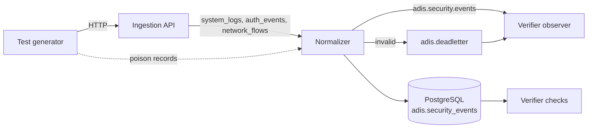

# End-to-end verification

The Phase 1 verification (`tests/e2e/phase1`) drives the real pipeline and checks every
guarantee the ingestion path makes:



Every component runs for real:
- the ingestion API and the normalizer run as separate `python -m` processes;
- Kafka and PostgreSQL run as containers;
- the outages are real container stops.

The latest result is in [PHASE1_VERIFICATION_REPORT.md](PHASE1_VERIFICATION_REPORT.md).

## Running it

> Point it only at **disposable** services. It creates topics, migrates the database,
> writes test events and **stops and restarts** the Kafka and database containers.

1. In `.env`, set `TEST_POSTGRES_PASSWORD`, plus `REDIS_PASSWORD` and
   `GRAFANA_ADMIN_PASSWORD`. Compose checks every required variable, even for services
   it does not start.
2. Start the broker and the disposable test database (`postgres-test`, compose profile
   `test`):

   ```bash
   make test-infra-up
   ```

   This runs `docker compose --profile test up -d --wait kafka postgres-test`.
3. Export the test endpoints and run the verification:

   ```bash
   export TEST_KAFKA_BOOTSTRAP_SERVERS=127.0.0.1:9092
   export TEST_DATABASE_URL=postgresql://adis_test:<TEST_POSTGRES_PASSWORD>@127.0.0.1:55432/adis_test
   make verify-phase1
   ```

   The equivalent direct command is `python -m tests.e2e.phase1 --report
   docs/PHASE1_VERIFICATION_REPORT.md`.

- **Exit codes:** `0` if every check passed, `1` if any failed, `2` if the endpoints are
  missing.
- **Output:** each run writes `.verification/<run id>/`, containing `report.md`,
  `report.json`, `api.log` and `normalizer.log` (JSON logs of the two services). The
  directory is git-ignored.

| Option | Default | Meaning |
|---|---|---|
| `--report PATH` | none | Also write the Markdown report here. |
| `--kafka-container` / `--database-container` | `adis-phase1-copy-kafka-1` / `adis-phase1-copy-postgres-test-1` | Containers stopped by the outage scenarios. |
| `--batch-events` | `300` | Events in the batch scenario. |
| `--outage-events`, `--outage-seconds` | `100`, `15` | Events sent during each outage, and how long it lasts. |
| `--no-faults` | off | Skip the two outage scenarios (no container is stopped) and the agent's API outage and crash. |

The same run is available as a test: `TEST_E2E=1 make test-e2e`. Set
`TEST_KAFKA_CONTAINER` and `TEST_DATABASE_CONTAINER` to override the container names.
Because it stops containers, it is opt-in even when the `TEST_*` endpoints are set.

The run never reads the repository's `.env`: the verifier builds its settings without it,
and the services and migrations run from the run directory with explicit settings. A
developer `.env` pointing at a hosted Supabase project (for example with
`DB_SSL_MODE=require`) therefore cannot leak into the verification.

## What it does

The run first:
1. migrates the database and ensures the topics exist;
2. starts the API (with a second token bound to the agent's id) and the normalizer;
3. waits until `GET /ready` answers `200`;
4. sends one warm-up event and waits until the normalizer is idle, so records left from
   earlier runs don't distort the latency.

Every generated event carries `metadata.verification = {run, scenario, seq}`, so the
counts include only this run's events. They come from the verifier's own observations:
- a partition-assigned reader on `adis.security.events` and `adis.deadletter`, which is
  never rebalanced;
- row counts per `event_id` in `adis.security_events`.

| Scenario | What happens | Checks |
|---|---|---|
| Single events | One system, one authentication and one network event, each via `POST /api/v1/events`. | Accepted, normalized, stored exactly once; `metadata.adis_ingestion` stored with the ingest client. |
| Batches | 300 mixed events in batches of 100 via `POST /api/v1/events/batch`. | The same, for every category. |
| Invalid events | Five invalid events (bad IP, unknown protocol, missing outcome, timestamp without a zone, `event_type` outside its category). A batch of 7 valid and 3 invalid events. Three poison records written straight to Kafka: not JSON, invalid payload, envelope/payload mismatch. | `422` naming each failing field. The partial batch accepts exactly the valid events and rejects by index. The poison records are dead-lettered by the normalizer and never stored. |
| Duplicates | 50 stored events re-sent in a batch, one event re-sent twice, and 10 new events each sent twice in one batch. | The API accepts all of them. No extra rows; already stored events are not published again; in-batch duplicates are published once. |
| Endpoint agent | A real `python -m apps.agent run` process, with an agent-bound token, tails a log file: 40 lines; then the API process stops for 15 s while 40 more lines are written; then 40 more lines, and the agent is killed 0.3 s later and restarted. | The registration reaches `adis.agents` (`active`); the agent keeps its events and retries while the API is down; every line is stored exactly once (rows = event ids = lines = written); every event is linked to the agent's row; `last_seen` advanced. |
| Temporary database failure | The database container stops, 100 events are sent, and it restarts 15 s later. | The API keeps accepting; the normalizer retries (`normalizer_retry`) instead of dead-lettering; everything is stored once after recovery; the normalizer survives. |
| Temporary Kafka failure | The broker stops while 100 events are sent in four concurrent batches; it restarts 15 s later. | `GET /ready` reports `503` during the outage; clients get `503` and retry; every event is eventually accepted, normalized and stored once; both services survive. |
| Whole run | | No accepted event lost (stored and normalized), exactly one row per event, no valid event dead-lettered, `event_id` unique in the table. |

The generator retries `429`, `5xx` and transport errors with capped exponential backoff,
like the agent does, and treats every other answer as final.

## Metrics

| Metric | Meaning |
|---|---|
| Sent | Events submitted to the API (including duplicates and invalid ones), plus records written straight to Kafka. |
| Accepted | Submissions answered `202` and listed as accepted. |
| Normalized | Distinct first-time events seen on `adis.security.events`. |
| Stored | Distinct first-time events with a row in `adis.security_events`. |
| Duplicates | Accepted re-submissions of an already submitted `event_id`. They must add no row and no publication. |
| Failed | Submissions the API rejected (4xx), or never accepted before the retry deadline (240 s). |
| Dead-lettered | The scenario's poison records found on `adis.deadletter`. |
| Latency p50 / p95 | From the generator's first send attempt to the normalized event appearing on `adis.security.events`, on one clock. In outage scenarios it includes the outage. The report also lists acceptance latency (the time until `202`). |

Service settings used for the run are listed in the report. Everything else keeps its
default, except a 200 ms normalizer poll timeout and a 5 s normalizer backoff ceiling,
which keep recovery quick.
